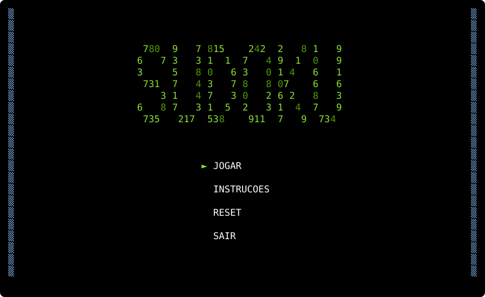
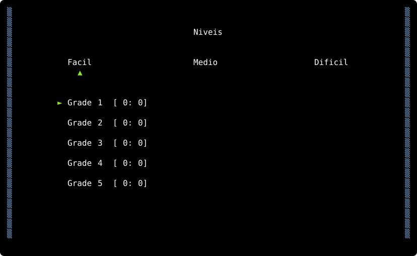
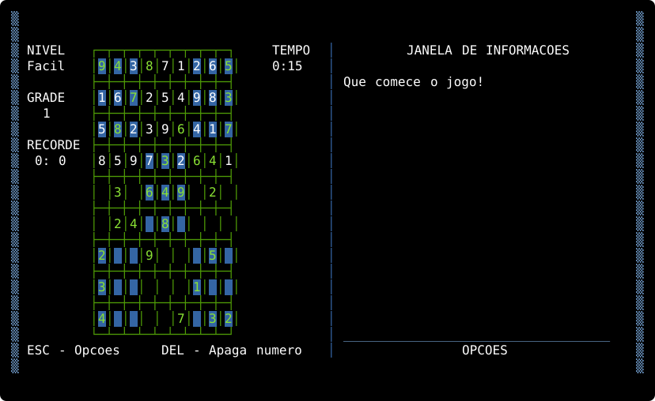
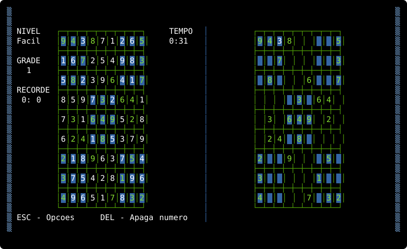

# sudoku

A terminal Sudoku game written in Pascal (Turbo Pascal style, `crt` unit) for the
Algorithms I class in college in 2012. The original source is kept unchanged in
[`original/Sudoku 2.2.txt`](original/Sudoku%202.2.txt). The game text is in Portuguese.

## Screenshots

<table>
  <tr>
    <td></td>
    <td></td>
  </tr>
  <tr>
    <td></td>
    <td></td>
  </tr>
</table>

## Run with Docker

Requires Docker and a terminal of at least 80x24.

```
./run.sh          # build the image and play
./run.sh build    # build the image only
./run.sh clean    # remove the image and the saved best times
```

## Playing

Three levels (Facil, Medio, Dificil) with five grades each. The best time for each
grade is saved.

| Key        | Action                                |
| ---------- | ------------------------------------- |
| Arrow keys | Move through the menus and the grid   |
| Enter      | Select                                |
| `1`-`9`    | Put a number in the selected cell     |
| Del        | Erase a number you placed             |
| Esc        | Open the in-game options              |

Menu: JOGAR (play), INSTRUCOES (instructions), RESET (erase all best times), SAIR (quit).

Best times are written to `tempos.bin` inside the `sudoku-data` Docker volume, so they
survive between runs.

## How it works

```text
Dockerfile
  build stage    debian:13.7-slim + fp-compiler 3.2.2
                 fpc -Mtp "original/Sudoku 2.2.txt"  ->  statically linked binary
  runtime stage  debian:13.7-slim
                 docker/entrypoint.sh
                   script -qf -c sudoku         # the game gets its own pty
                     | docker/cp437-to-utf8.pl  # CP437 glyph bytes -> UTF-8
```

The game draws its frame and grid with CP437 characters, which a UTF-8 terminal shows
as garbage. Free Pascal's `crt` counts one byte per screen column, so writing UTF-8
from the Pascal code would break its cursor tracking. The filter translates the bytes
after `crt` has written them, which leaves the original source untouched.

The base image tag and the compiler package version are pinned. If Debian drops the
pinned `fp-compiler` version and the build fails, remove the version pin in the
`Dockerfile` and let the base image tag fix the compiler.

## License

MIT, see [LICENSE](LICENSE).
